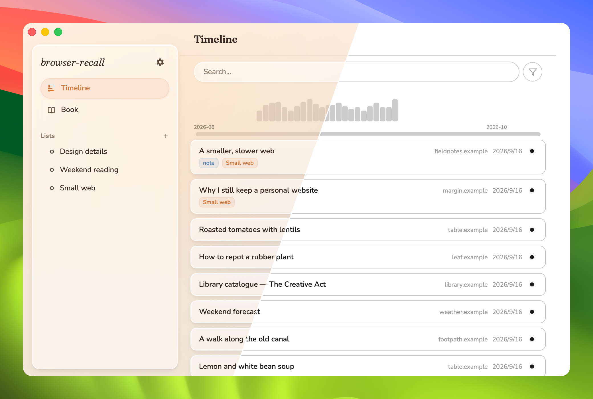
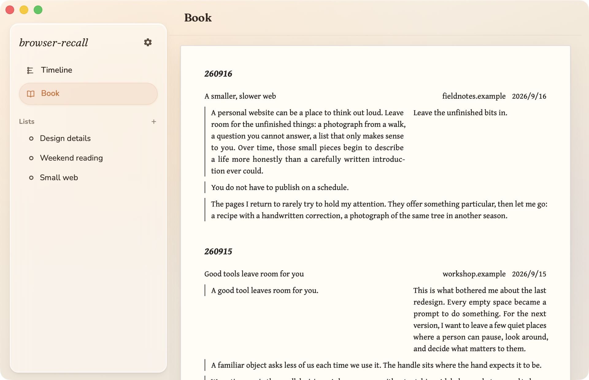
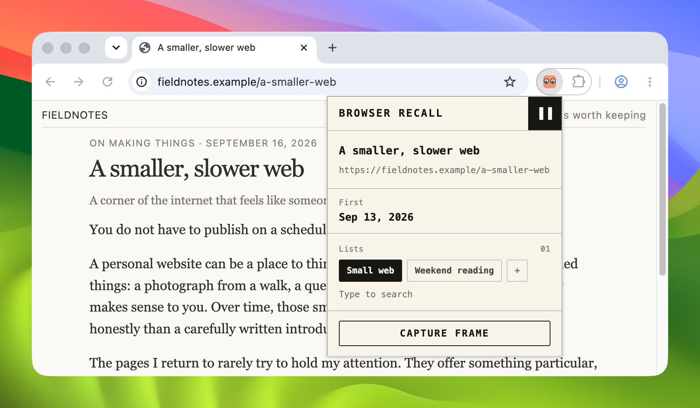
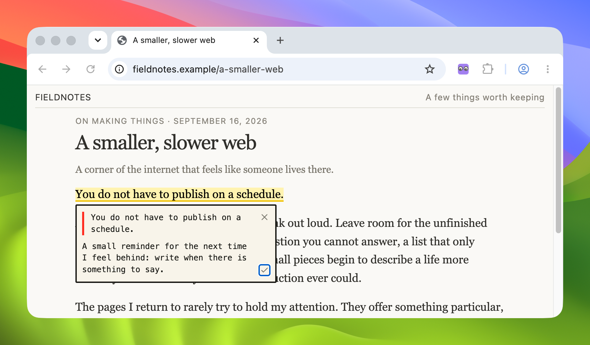

# Browser Recall

Help browser remember things.

- Keep browser **history** with no time limit. Capture compact webpage **snapshots**.
- Organize webpages with **lists**. A page can belong to more than one list, as it should.
- Add highlights and **notes** directly on the webpage and find them again in context.
- **Search** across titles, URLs, highlights, notes, and snapshots from one place.

Browser Recall stores your data using readable formats such as JSON and Markdown. You can read the files, search them with file tools, or ask an agent to analyze them. An [AGENTS.md](crates/daemon/resources/data-AGENTS.md) in the data directory explains the layout and conventions. Nothing in the collection depends on Browser Recall to remain readable. You own your data.

## Gallery

<table>
  <tr>
    <td>
      

        
         
        Timeline
      

    </td>
    <td>
      

        
         
        Book
      

    </td>
  </tr>
  <tr>
    <td>
      

        
         
        See page details in browser
      

    </td>
    <td>
      

        
         
        Take notes in browser
      

    </td>
  </tr>
</table>

## Install

<!-- Replace APP_ID before publishing. -->

Install both the desktop app and the browser extension.

Desktop app is supported on macOS and on Windows. The signed macOS app is available as a paid download from the [App Store](https://apps.apple.com/app/idAPP_ID). You can also [build from source](DEVELOPMENT.md#build-and-run).

Browser extension is free on the [Chrome Web Store](https://chromewebstore.google.com/detail/bgghgkobpfgcinpjjeeconciefclpdgp) and [Firefox Add-ons](https://addons.mozilla.org/firefox/addon/browser-recall-connector/). Edge and Orion are supported using the Chromium extension.

## Alternatives

[Zotero](https://www.zotero.org/) is an excellent tool for organizing research materials, including webpages. Browser Recall is a smaller, more open and more web-centric version of it. Feature-wise, Zotero doesn’t support history tracking or taking notes in browser.

[Hister](https://hister.org/) is another tool in this space with similar browser integration. Compared with Browser Recall, it puts more emphasis on search and retrieval.

File an issue if you think someone else deserves a mention.

---

[Development](DEVELOPMENT.md) · [Privacy](docs/PRIVACY.md) · MIT licensed
